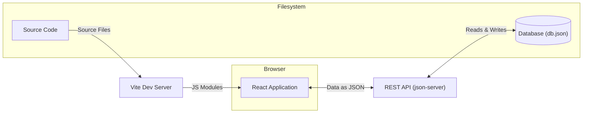

# Phonebook Frontend

## Architecture



*Arrows show the direction of data flow, not which side initiates the request.*

## Setup

```
npm install
npm run server   # terminal 1 (API on port 3000)
npm run dev      # terminal 2 (frontend on port 5173)
```
