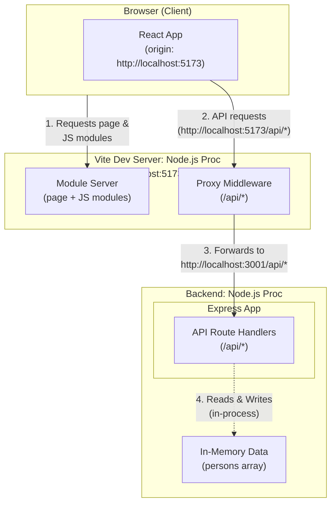
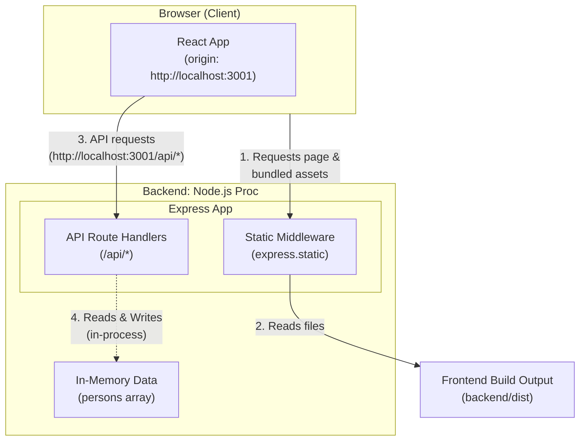
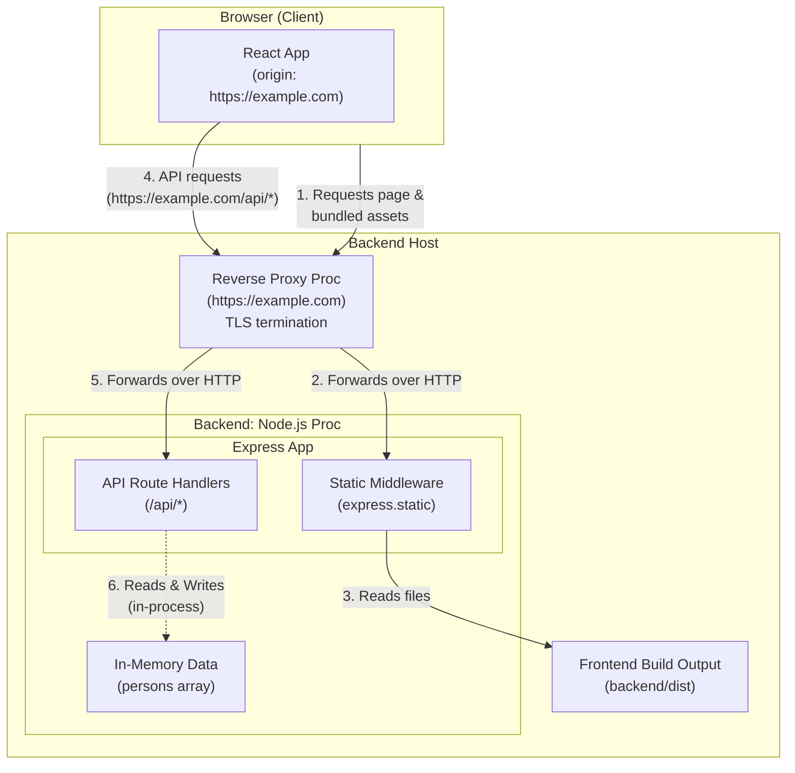
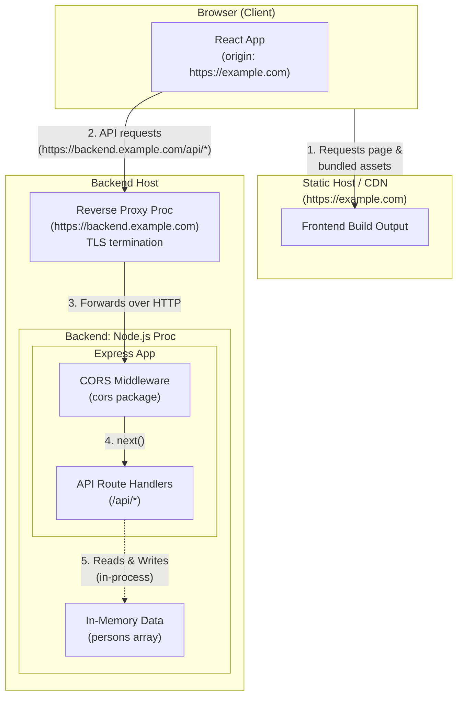

# Full Stack Phonebook

This repository contains the Full Stack Open phonebook application (Exercises 3.1–3.11).

- **Live Application:** [Full Stack Phonebook](https://your-coolify-url.com)

> **Note:** Data is stored in memory, in the backend process. It resets whenever the backend restarts.

## Installation

```bash
cd backend
npm install
cd ../frontend
npm install
```

## Development



*Architecture diagram showing the request flow in development. Solid arrows show who initiates each request. Dotted arrows show in-process data access. The browser only talks to `localhost:5173`, so all requests are same-origin and no CORS is needed.*

1. Terminal 1 (Express server):

    ```bash
    cd backend
    npm run dev
    ```

2. Terminal 2 (Vite dev server):

    ```bash
    cd frontend
    npm run dev
    ```

3. Open `http://localhost:5173` in your browser.

The Vite dev server updates the frontend instantly with Hot Module Replacement (HMR), and proxies `/api/*` requests to the Express backend on port 3001 (configured in `vite.config.js`). The frontend uses the relative URL `/api/persons`, so the requests go through the proxy and no CORS is needed.

The backend restarts automatically when you change its files. This also resets the in-memory data.

## Local Production



*Architecture diagram showing the request flow in local production. Solid arrows show who initiates each request or file read. Dotted arrows show in-process data access. `backend/dist` is generated beforehand by `npm run build:frontend`.*

1. Build the frontend into the backend:

    ```bash
    cd backend
    npm run build:frontend
    ```

    This script (defined in `backend/package.json`) runs `npm run build` in the `frontend` folder:

    ```json
    "build:frontend": "cd ../frontend && npm run build"
    ```

    The frontend's `vite.config.js` sets the build output to `backend/dist`, so Vite writes the production build directly into the backend. No separate copy step is needed:

    ```js
    build: {
      outDir: "../backend/dist", // write the build output into the backend
      emptyOutDir: true,         // clear old files first (required because outDir is outside the frontend folder)
    },
    ```

2. Start the production server:

    ```bash
    npm start
    ```

3. Open `http://localhost:3001` in your browser.

Express now serves both the production build of the React frontend and the API from the same origin, so neither the Vite proxy nor CORS is needed.

## Production

### Unified Deployment (Same Origin)



*Architecture diagram showing the request flow in a unified production deployment. Solid arrows show who initiates each request or file read. Dotted arrows show in-process data access. The React app and the API share the origin `https://example.com`, so no CORS is needed. `backend/dist` is generated by `npm run build:frontend`.


### Split Deployment (Cross-Origin)



*Architecture diagram showing the request flow in a split production deployment. Solid arrows show who initiates each request. Dotted arrows show in-process data access. The CORS middleware adds CORS headers to responses, and the browser enforces them. Preflight (`OPTIONS`) requests are answered by the CORS middleware and never reach the route handlers. The backend URL is set at build time via `VITE_API_URL`.*
